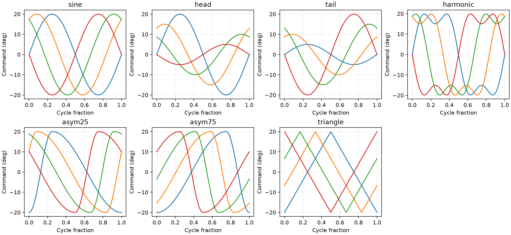
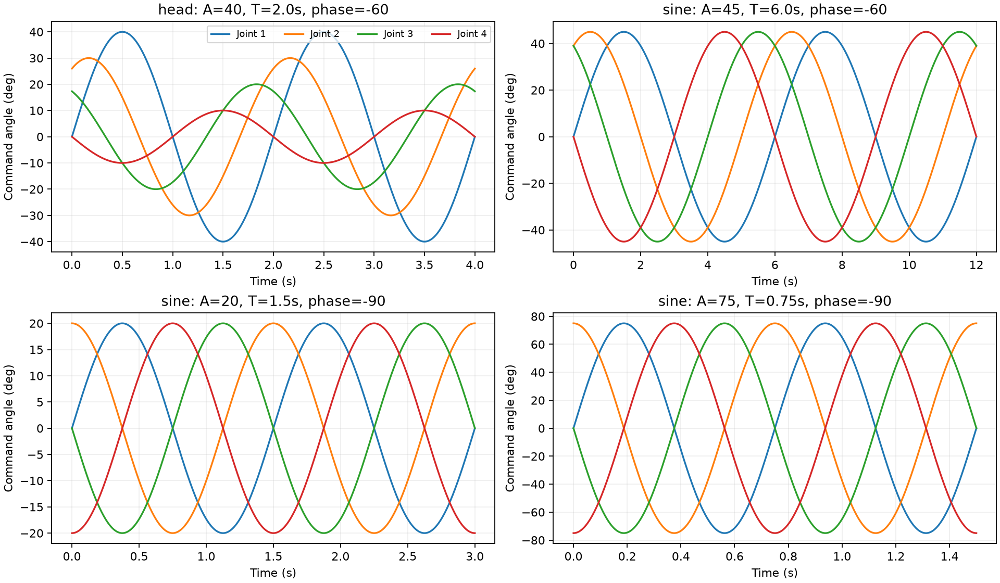

# バルーンロボット：x+推進動作の検証レポート

作成日：2026-11-21。実測ではなく、このリポジトリのMuJoCoモデルで得た結果。既存結果を集計した資料で、新しい物理計算は行っていない。

## 1. 結論と資料の読み方

今回の推奨候補は **関節1〜4の指令振幅40/30/20/10°、正弦波、周期2秒、位相差−60°**。中性浮力・無風・現行OBJ表面抵抗の96秒評価で、x方向に5.817m、後半平均0.06318m/s。標本上の実角度最大44.01°、追従RMSE11.57°、トルク飽和0%だった。

最初の速度重視探索では75°・0.75秒・−90°の正弦波が速かったが、実角度約91°、飽和約87%だった。後から指定された実角度60°以下の条件には適合しない。現在の推奨候補は速度より負荷指標を優先している。

- [全試行の条件・結果表](all_trials.md)：再評価を含む各試行の数値。
- [全試行の機械可読データ](all_trials.json)：全フィールドを省略せず収録。実験名＋段階名＋IDで識別する。
- [推奨設定](../../config/xplus_practical.yaml)、[3候補の比較設定](../../config/xplus_practical_comparison.yaml)。
- この資料の表は丸め表示。元データに丸め前の値を保存している。

## 2. モデル・環境条件

検証環境の確認値：Python 3.12.1、mujoco 4.0.1、numpy 2.5.5、PyYAML 6.0.3、matplotlib 3.11.2。依存関係はpyproject.toml・uv.lockで管理。

5個の剛体バルーンを4個のY軸回転関節で接続。初期状態はX軸に沿って真っすぐ、全関節0°、静止。基部は3次元自由浮遊で、高さ3mから開始する。関節1はバルーン1と2の間、関節4は4と5の間。波は主にXZ面で曲げる運動であり、上から見た左右蛇行とは異なる。

| 項目 | 使用値・扱い |
|---|---|
| バルーン外形寸法 | X 0.450m × Y 0.650m × Z 0.300m |
| 外観・表面抵抗メッシュ | assets/balloon_87.obj、倍率1、追加回転0°、中心合わせあり、寸法への再フィットなし |
| 隣接隙間 / 中心間隔 | 0.010m / 0.460m |
| 浮力用体積 | 1個0.070m³（70L）。外形メッシュから計算せず独立に指定 |
| 膜質量 | 1個0.026kg |
| ヘリウム密度 / 質量 | 0.166kg/m³ / 1個0.01162kg |
| 関節質量・形状 | 1個0.022kg、半径0.018m、長さ0.050m |
| バラスト前の総質量 | 0.27610kg |
| 中性浮力時のバラスト | 合計0.14565kg、各バルーン0.02913kgを中心からZ方向−0.150mに配置 |
| 中性浮力時の総質量 | 0.42175kg |
| 重力 | 9.81m/s² |
| 空気密度 / 粘性 | 1.205kg/m³ / 0.0000181Pa·s |
| 浮力 | 1個0.8274735N。各バルーンのローカル原点に上向き外力 |
| 風 | [0,0,0]m/s |
| 慣性 | バルーンは均質楕円体近似、関節円柱・バラストを合成 |
| 位置制御ゲイン | kp=0.3、kv=0.03（MuJoCoの位置アクチュエータ） |
| 関節粘性減衰 | 0.002 |
| トルク上限 | ±0.18N·m。実機の連続許容値を確認した値ではない |
| 指令制限 / 関節制限 | 指令±90°にクリップ、物理関節も±90°の柔らかい制限 |
| 数値積分 | モデルで積分法を上書きせず、MuJoCo既定のEuler |
| 衝突 | バルーン同士・地面とも衝突なし。地面は表示専用 |

**60°は物理関節のハードストップではない。** 今回は計算後に実角度の標本最大が60°以下かで選別した。モデルの関節制限を60°へ変更した実験ではない。

中性浮力は重量と浮力を釣り合わせる設定で、水平姿勢や高度を固定する制御ではない。したがって上下・横方向にも変位が出る。既定設定のneutral=falseとは重量・慣性も異なる。

### 空力モデル

一次探索は軽量な楕円体モデル。係数は[0.5,0.25,1.5,1.0,1.0]（鈍頭抗力、細長物体抗力、角抗力、Kutta揚力、Magnus揚力）。

最終評価はOBJ表面抵抗モデル。表面圧力係数1.0とし、各三角形の法線n、面積S、相対速度vから、風上面に `F = −0.5ρ C S max(v·n,0)²n` を与える。面の回転速度・モーメントも含め、MuJoCoの二次流体力との二重加算を避けている。粘性は楕円体近似を併用する。

CFD、後流、バルーン間の風の遮蔽、膜変形は含まない。二つの空力モデルで順位が変わるため、楕円体での速度を最終性能として扱わない。

## 3. 動作パラメータの意味

| パラメータ | 意味・注意点 |
|---|---|
| family | 波の種類。後述の7種類または登録パターンID |
| amplitude / A [°] | 指令角の振幅パラメータ。±Aなら往復の全幅は2A。実角度とは異なる |
| period / T [s] | 1周期のシミュレーション時間。短いほど速く振る。再生速度とは別 |
| phase / Δφ [°] | 隣接関節間の位相差。式は `sin(2πt/T − (n−1)Δφ)` |
| motion_scale | 全指令角への倍率。登録波形は元の式の標本最大に合わせて拡大縮小 |
| bend_fraction | 緩急波で−Aから+Aへ動く時間の割合。0.25または0.75 |
| neutral | バラストを追加して中性浮力にするか |
| duration [s] | 物理計算する時間。実際の待ち時間とは異なる |
| dt / timestep [s] | 物理計算の時間刻み。小さいほど計算が重くなる |

負の位相差では関節番号の大きい側の位相が進む。−60°なら隣同士でT/6秒、−90°ならT/4秒の位相差。角度の正負はY軸回転の符号であって、x+への推進方向そのものではない。

**設定ファイルで実際に有効な項目に注意。** 推奨設定は `mode: expressions` なので、角度はexpressions内のA=40、T=2、d=−60/360で決まる。残っている `amplitude_deg:30`、`phase_step_deg:−45` はこのモードでは使わない。`control.period` は有効で式の時間を変換する。`frequency` はperiodが指定されていると周期指定より優先されない。

## 4. 各波形はどのように動くか

n=1〜4、p=2πt/T−(n−1)Δφ、u=(t/T−(n−1)Δφ/360) mod 1 とする。式の出力単位は度。

| ID | 指令式・振幅分布 | 動きの説明 |
|---|---|---|
| sine | A sin(p)、全関節同振幅 | 滑らかに往復する正弦進行波。コード上はmode=traveling |
| head | A(5−n)/4 sin(p) | 関節1側ほど大きい。A=40なら40/30/20/10°。今回の推奨 |
| tail | An/4 sin(p) | 関節4側ほど大きい。A=40なら10/20/30/40° |
| harmonic | A(sin(p)+0.3sin(3p))/0.93 | 3次高調波を加えて往復中の速度配分を変える。肩が二つ出る形で、単純に滑らかさが増すわけではない。実際の指令ピークは約0.9895A |
| asym25 | 前半区間−cos、後半区間cosで接続 | −A→+Aを周期の25%、+A→−Aを75%で行う。各端点では速度0 |
| asym75 | 同じ式で時間割合75:25 | −A→+Aがゆっくり、戻りが速い。正方向の送りと推進方向は同義ではない |
| triangle | A(1−4abs(u−0.5)) | −A→+A→−Aを一定角速度で往復。折返しで角速度が急変するため、速度重視探索のみで使用 |

緩急波の正確な式は、f=bend_fractionとして `u<f: −A cos(πu/f)`、それ以外は `A cos(π(u−f)/(1−f))`。



図はA=20°、T=1秒、位相差−60°に揃えた**指令角**で、実角度の軌跡ではない。head/tailは振幅分布が異なる。三角波・高調波・緩急波は波の形も異なる。

### 推奨波を具体的に読む

関節指令は次の4本。tは秒。

- θ1(t)=40 sin(πt)
- θ2(t)=30 sin(πt+π/3)
- θ3(t)=20 sin(πt+2π/3)
- θ4(t)=10 sin(πt+π)

全関節2秒で1往復し、隣接位相差は約0.333秒。全関節を同時に曲げるのではなく、曲がる位置が関節4側から1側へ伝わる。振幅は1側が大きく、4側が小さい。

初期の実角度は全て0°だが、時刻0の目標は約[0,25.98,17.32,0]°。**今回の探索には立ち上げランプを入れていない。** 滑らかな周期波でも、実機への開始指令は別に検討する必要がある。推奨正弦波の周期中の最大指令角速度は順に約126/94/63/31°/s（式からの計算値）。実サーボの測定速度ではない。



## 5. 探索の範囲と段階

### 速度重視の探索

登録13パターン＋追加7波形。A=10/20/30/45/60/75/90°、T=0.5/1/2/4/8秒。追加波形の位相差は−120/−90/−60/−30/+30/+60/+90/+120°。登録パターンは式に含まれる関節間の関係を維持し、振幅と周期だけ変える。

登録パターンのAは、1周期401点で調べた元の指令最大を基準に倍率を調整した値。登録パターンの記録にあるphase=0は「位相差0°へ変更した」という意味ではなく、追加の位相操作をしていないという印。

| 段階 | 試行数 | 空力 | 時間 | 刻み | 内容 |
|---|---:|---|---|---|---|
| screen | 2415 | 楕円体 | 16秒 | 2ms | 広域探索 |
| mesh | 232 | 表面抵抗 | 32秒 | 2ms | 全体上位60＋各波形・各周期の上位2を重複排除 |
| verified | 24 | 表面抵抗 | 64秒 | 2/1ms | 上位8条件×中性2ms、中性1ms、非中性2ms |
| refined | 86 | 表面抵抗 | 32秒 | 2ms | 上位3波形のA±15°、T×0.75/1/1.25、位相±15°の近傍＋小振幅候補＋基準 |
| final | 30 | 表面抵抗 | 64秒 | 2/1ms | 上位候補と小振幅候補・基準を再評価 |
| convergence | 1 | 表面抵抗 | 64秒 | 0.5ms | 最終首位の刻み依存確認 |
| baseline_32 | 2 | 表面抵抗 | 32秒 | 2ms | 従来条件の中性あり・なし |

同一条件が異なるIDで重複する場合がある。試行数は独立した波形種類数ではない。最終上位には例えばg1544とr013の同一条件が含まれる。

### 実現性を重視した追加探索

波形はsine/head/tail/harmonic/asym25/asym75の6種類。周期1.5/2/3/4/6秒、位相差−90/−60/−30°。

| 系列 | 指令振幅 | 実角度の選別上限 | 一次探索 | 表面抵抗再評価 | 長時間検証 |
|---|---|---|---|---|---|
| practical_search | 5/10/15/20/25/30° | 40°（回答前の仮条件） | 540試行、24秒・2ms、楕円体 | 37試行、48秒・1ms | 5試行、96秒・0.5ms |
| practical_search_60 | 上記＋35/40/45° | 60°（ユーザー指定） | 810試行、24秒・2ms、楕円体 | 37試行、48秒・1ms | 5試行、96秒・0.5ms |

全て中性浮力・無風。540条件は810条件の一部と重複し、合わせて1350種類の異なる条件ではない。全系列の試行記録数は後述の集計に示す。

選別は、実角度最大が上限以下、追従RMSE≤12°、トルク飽和率≤1%、後半X速度>0。一次で通過した速度上位30と各波形の通過上位5を残し、表面抵抗で再び選別、上位5を96秒検証した。12°と1%は今回置いた仮の基準で、実サーボメーカーの保証値ではない。

## 6. 結果指標の定義

| 記録名 | 定義 |
|---|---|
| dx,dy,dz | 初期の全体重心からの最終変位[m]。基部や先端の変位ではない |
| speed | dx÷全計算時間。全時間の平均X速度 |
| late_speed | 後半に収まる整数周期区間での重心X変位÷その区間時間。順位に使用 |
| actual_max_deg | 計算全体で標本化した4関節の実角度の絶対値の最大 |
| tracking_rmse_deg | 標本時刻・全4関節の目標角と実角度の二乗誤差平均の平方根。始動も含む |
| saturation_fraction | 標本時刻でどれか1関節の絶対トルクが0.1799N·m以上だった割合。全関節平均ではない |
| wall_seconds | その試行の実行にかかった実時間。並列実行の負荷に左右される |

後半区間は `k=max(1,floor(duration/(2T)))`、開始時刻 `duration−kT`。例えば96秒・T=2秒なら48〜96秒、64秒・T=0.75秒なら32.5〜64秒。最寄りのステップ時刻を使う。正のdxだけで判定せず、後半速度が正か確認した。

角度・誤差・飽和は10ステップごとの標本。2ms計算では20ms間隔、1msでは10ms、0.5msでは5ms間隔。その間の短い超過を厳密に排除する検査ではない。飽和0%も「全時刻で余裕十分」「熱的に安全」という意味ではない。ピークトルク、電流、消費電力、実角速度、温度は保存指標に含まれない。

## 7. 実角度60°条件の最終結果

全行：中性浮力、表面抵抗、96秒、時間刻み0.5ms。速度が高い順。

| ID / 波形 | A [°] | T [s] | 位相差 [°] | dx [m] | 全時間速度 [m/s] | 後半速度 [m/s] | 実角最大 [°] | RMSE [°] | 飽和率 [%] | dy / dz [m] |
| --- | --- | --- | --- | --- | --- | --- | --- | --- | --- | --- |
| p0379 / head | 40 | 2.0 | -60 | 5.8174 | 0.06060 | 0.06318 | 44.01 | 11.57 | 0.0000 | -0.230 / -0.420 |
| p0538 / harmonic | 45 | 6.0 | -60 | 5.0853 | 0.05297 | 0.05653 | 51.32 | 9.37 | 0.0677 | -0.211 / -1.014 |
| p0133 / sine | 45 | 6.0 | -60 | 5.0465 | 0.05257 | 0.05652 | 46.33 | 8.64 | 0.0417 | -0.187 / -0.943 |
| p0808 / asym75 | 45 | 6.0 | -60 | 4.9352 | 0.05141 | 0.05583 | 49.72 | 9.03 | 0.0365 | -0.166 / -1.108 |
| p0673 / asym25 | 45 | 6.0 | -60 | 4.6896 | 0.04885 | 0.05327 | 50.63 | 8.71 | 0.0677 | -0.149 / -0.798 |

### 比較候補の選び方

- **速度と負荷のバランス**：head 40°・2秒。実角最大44°で60°まで約16°の標本上の余裕。トルク飽和0%、ただしRMSE11.57°で選別基準12°に近い。
- **ゆっくり動かす候補**：sine 45°・6秒。後半0.05652m/sで推奨首位の約89%の速度。追従RMSE8.64°。周期中の最大指令角速度は約47.1°/s。全体の上下移動は大きめ。
- **小振幅の比較候補**：sine 20°・1.5秒。実角最大36.9°、飽和0%。指令20°でも実角20°以内ではない。
- harmonic 45°・6秒とsine 45°・6秒の速度差は非常に小さい。実機での優劣を主張できる差ではない。

### 先行した実角度40°条件の最終結果

全行：中性浮力、表面抵抗、96秒、0.5ms。IDは60°系列とは別物なので混同しない。

| ID / 波形 | A [°] | T [s] | 位相差 [°] | dx [m] | 全時間速度 [m/s] | 後半速度 [m/s] | 実角最大 [°] | RMSE [°] | 飽和率 [%] | dy / dz [m] |
| --- | --- | --- | --- | --- | --- | --- | --- | --- | --- | --- |
| p0045 / sine | 20 | 1.5 | -90 | 4.5523 | 0.04742 | 0.05053 | 36.92 | 11.97 | 0.0000 | -0.067 / -0.285 |
| p0240 / head | 25 | 1.5 | -90 | 4.3185 | 0.04498 | 0.04822 | 31.37 | 10.87 | 0.0000 | -0.087 / -0.403 |
| p0358 / harmonic | 30 | 6.0 | -60 | 3.8306 | 0.03990 | 0.04397 | 35.74 | 8.18 | 0.0000 | -0.038 / -0.769 |
| p0443 / asym25 | 30 | 3.0 | -30 | 3.8763 | 0.04038 | 0.04280 | 38.09 | 10.30 | 0.0000 | -0.059 / 0.090 |
| p0259 / head | 30 | 2.0 | -60 | 3.8054 | 0.03964 | 0.04205 | 34.78 | 9.42 | 0.0000 | -0.067 / -0.316 |

### 速度重視探索との比較

次表は64秒・1ms・中性浮力の結果。96秒の表と移動距離を直接比較せず、時間条件の違いも含めて読む。速度重視の行は60°条件を課していない。

| ID / 波形 | A [°] | T [s] | 位相差 [°] | dx [m] | 全時間速度 [m/s] | 後半速度 [m/s] | 実角最大 [°] | RMSE [°] | 飽和率 [%] | dy / dz [m] |
| --- | --- | --- | --- | --- | --- | --- | --- | --- | --- | --- |
| r028 / sine | 75 | 0.75 | -90 | 14.0108 | 0.21892 | 0.22415 | 91.19 | 59.51 | 86.6094 | -1.229 / 0.846 |
| r010 / triangle | 90 | 0.75 | -90 | 13.8695 | 0.21671 | 0.22194 | 91.45 | 59.07 | 82.6562 | -1.234 / 0.918 |
| g1544 / triangle | 90 | 1.0 | -90 | 12.9945 | 0.20304 | 0.20870 | 89.01 | 47.20 | 64.8281 | -0.792 / -0.195 |
| r013 / triangle | 90 | 1.0 | -90 | 12.9945 | 0.20304 | 0.20870 | 89.01 | 47.20 | 64.8281 | -0.792 / -0.195 |
| g0664 / sine | 75 | 1.0 | -90 | 13.0112 | 0.20330 | 0.20833 | 86.76 | 48.35 | 62.9531 | -0.816 / -0.037 |
| r031 / sine | 75 | 1.0 | -90 | 13.0112 | 0.20330 | 0.20833 | 86.76 | 48.35 | 62.9531 | -0.816 / -0.037 |
| g1624 / harmonic | 20 | 1.0 | -90 | 2.4871 | 0.03886 | 0.04226 | 34.37 | 15.07 | 0.0000 | -0.009 / -0.196 |
| g0794 / asym25 | 20 | 2.0 | -30 | 1.9721 | 0.03081 | 0.03312 | 33.44 | 11.48 | 0.0000 | 0.002 / -0.146 |
| baseline / sine | 30 | 2.0 | -45 | 4.1195 | 0.06437 | 0.06768 | 49.26 | 15.55 | 0.0000 | -0.081 / -0.214 |
| stationary / sine | 0 | 2.0 | -45 | 0.0002 | 0.00000 | 0.00000 | 12.89 | 6.89 | 0.0000 | 0.001 / -0.135 |

首位の0.5ms再計算：

| ID / 波形 | A [°] | T [s] | 位相差 [°] | dx [m] | 全時間速度 [m/s] | 後半速度 [m/s] | 実角最大 [°] | RMSE [°] | 飽和率 [%] | dy / dz [m] |
| --- | --- | --- | --- | --- | --- | --- | --- | --- | --- | --- |
| r028 / sine | 75 | 0.75 | -90 | 13.9157 | 0.21743 | 0.22267 | 91.25 | 59.57 | 86.6172 | -1.082 / 0.917 |

速度重視首位の後半速度は1msで0.22415、0.5msで0.22267m/s（約0.66%変化）。前回の「約3.3倍」は、同じ64秒・1msの従来条件0.06768m/sとの比率。新しい実現性候補が従来条件より速いという主張ではない。新候補の主な改善は、角度・追従・飽和の条件を満たすこと。

### 非中性浮力の評価

最初のfinal段階では中性浮力なしも計算した。以下は64秒・2msの結果。上昇・姿勢変化により後半X速度が負になる例がある。今回の推奨候補head 40°・2秒については非中性浮力での長時間検証を行っていない。

| ID / 波形 | A [°] | T [s] | 位相差 [°] | dx [m] | 全時間速度 [m/s] | 後半速度 [m/s] | 実角最大 [°] | RMSE [°] | 飽和率 [%] | dy / dz [m] |
| --- | --- | --- | --- | --- | --- | --- | --- | --- | --- | --- |
| r028 / sine | 75 | 0.75 | -90 | 2.6071 | 0.04074 | -0.00685 | 76.90 | 51.97 | 68.1875 | 0.988 / 134.506 |
| r010 / triangle | 90 | 0.75 | -90 | 2.7353 | 0.04274 | -0.00666 | 77.85 | 50.69 | 66.2500 | 1.001 / 134.624 |
| g1544 / triangle | 90 | 1.0 | -90 | 3.9254 | 0.06133 | -0.00412 | 84.53 | 40.74 | 46.0000 | 0.783 / 131.800 |
| r013 / triangle | 90 | 1.0 | -90 | 3.9254 | 0.06133 | -0.00412 | 84.53 | 40.74 | 46.0000 | 0.783 / 131.800 |
| g0664 / sine | 75 | 1.0 | -90 | 3.7688 | 0.05889 | -0.00438 | 83.48 | 41.37 | 39.4688 | 0.793 / 131.803 |
| r031 / sine | 75 | 1.0 | -90 | 3.7688 | 0.05889 | -0.00438 | 83.48 | 41.37 | 39.4688 | 0.793 / 131.803 |
| g1624 / harmonic | 20 | 1.0 | -90 | 14.2780 | 0.22309 | 0.26681 | 31.53 | 14.31 | 0.0000 | 1.964 / 125.525 |
| g0794 / asym25 | 20 | 2.0 | -30 | 3.6204 | 0.05657 | 0.08293 | 30.74 | 12.98 | 0.0000 | 0.452 / 109.456 |
| baseline / sine | 30 | 2.0 | -45 | -4.6140 | -0.07209 | -0.16369 | 36.65 | 16.06 | 0.0000 | -0.901 / 111.210 |
| stationary / sine | 0 | 2.0 | -45 | -12.3002 | -0.19219 | -0.31881 | 13.23 | 7.28 | 0.0000 | -1.948 / 120.270 |

## 8. 波形ごとの評価範囲

下表は60°系列の48秒表面抵抗評価から、選別条件を通過した各波形の最速を示す。一次探索の順位を使って絞ったため、波形ごとの全条件を表面抵抗で計算した表ではない。96秒の最終表とも区別する。

| ID / 波形 | A [°] | T [s] | 位相差 [°] | dx [m] | 全時間速度 [m/s] | 後半速度 [m/s] | 実角最大 [°] | RMSE [°] | 飽和率 [%] | dy / dz [m] |
| --- | --- | --- | --- | --- | --- | --- | --- | --- | --- | --- |
| p0133 / sine | 45 | 6.0 | -60 | 2.3369 | 0.04869 | 0.05667 | 46.33 | 8.71 | 0.0833 | -0.002 / -0.438 |
| p0379 / head | 40 | 2.0 | -60 | 2.8027 | 0.05839 | 0.06378 | 44.00 | 11.60 | 0.0000 | -0.014 / -0.220 |
| p0258 / tail | 45 | 2.0 | -90 | 0.8596 | 0.01791 | 0.01986 | 44.41 | 10.74 | 0.0417 | 0.021 / 0.083 |
| p0538 / harmonic | 45 | 6.0 | -60 | 2.3739 | 0.04946 | 0.05671 | 51.31 | 9.46 | 0.1458 | -0.004 / -0.463 |
| p0673 / asym25 | 45 | 6.0 | -60 | 2.1352 | 0.04448 | 0.05333 | 50.63 | 8.81 | 0.1458 | 0.002 / -0.377 |
| p0808 / asym75 | 45 | 6.0 | -60 | 2.2577 | 0.04704 | 0.05591 | 49.71 | 9.14 | 0.0833 | -0.001 / -0.542 |

## 9. 登録済み13パターンの説明と式

以下はローカル登録ファイルの式。Studioの説明に含まれる仮寸法や以前の角度を、そのまま今回の物理条件として使ってはいない。今回の物理条件は第2節、振幅と周期の変更は第5節に従う。特にslow-sweepは説明に60°とある一方、現在の式のAは20。実際の探索は式を評価して振幅を正規化した。


### air-01：空中推進 01 — 尾側ほど大きい進行波

関節4側ほど振幅が大きい正弦波。登録位相は追加tailの負位相条件と異なる。 元の完全周期：8.0秒。

```text
A = 20
N = 4
T = 8
phi = pi/3
a(n) = A*n/N
x(n,t) = a(n)*sin(2*pi*t/T - (n-1)*phi)
```

### air-02：空中推進 02 — 尾側を強調した緩急波

ゆっくり正側に構え、順番に負側へ振り抜き、同時に戻して休む。 元の完全周期：8.0秒。

```text
A = 20
N = 4
B = 3
F = 0.6
L = 0.15
R = 3
W = 0.95
E = B + F + (N-1)*L
T = E + R + W
c(z) = min(1, max(0, z))
h(z) = (1-cos(pi*c(z)))/2
u(t) = t - T*floor(t/T)
a(n) = A*n/N
x(n,t) = a(n)*(h(u(t)/B) - 2*h((u(t)-B-(n-1)*L)/F) + h((u(t)-E)/R))
```

### air-03：空中推進 03 — S字を経由して戻す

振り抜いた後、隣接関節が逆符号になるS字を経由して戻す。 元の完全周期：8.0秒。

```text
A = 20
N = 4
B = 3
F = 0.6
L = 0.15
R = 3
W = 0.95
E = B + F + (N-1)*L
T = E + R + W
c(z) = min(1, max(0, z))
h(z) = (1-cos(pi*c(z)))/2
u(t) = t - T*floor(t/T)
C = 1.2
k(n) = cos(pi*(n-1))
x(n,t) = A*(h(u(t)/B) - 2*h((u(t)-B-(n-1)*L)/F) + (1+k(n))*h((u(t)-E)/C) - k(n)*h((u(t)-E-C)/(R-C)))
```

### air-04：空中推進 04 — 尾側2関節だけで振る

関節1・2は目標0°、3・4のみ動かす。 元の完全周期：8.0秒。

```text
A = 20
T = 8
phi = pi/3
a(n) = A*max(0, n-2)/2
x(n,t) = a(n)*sin(2*pi*t/T - max(0,n-3)*phi)
```

### air-05：空中推進 05 — 包絡付き尾側進行波

正弦波にsin²の包絡をかけ、周期境界で指令を0°にする。 元の完全周期：8.0秒。

```text
T = 8
u(t) = t/T-floor(t/T)
x(n,t) = 5*n*sin(pi*u(t))*sin(pi*u(t))*sin(2*pi*u(t)-(n-1)*pi/3)
```

### air-06：空中推進 06 — 左右交互の緩急波

緩急波の符号を交互に反転。完全な符号付き周期は16秒で、8秒は半周期。 元の完全周期：16.0秒。

```text
T = 16
h(z) = (1-cos(pi*min(1,max(0,z))))/2
u(t) = t/T-floor(t/T)
v(t) = 16*u(t)-8*floor(2*u(t))
d(t) = cos(pi*floor(2*u(t)))
x(n,t) = d(t)*5*n*(h(v(t)/3)-2*h((v(t)-3-(n-1)*0.15)/0.6)+h((v(t)-4.05)/3))
```

### air-07：空中推進 07 — 前後逆位相の尾振り

関節1・2と3・4を二群に分け、符号反転・位相ずれ・包絡を与える。厳密な180°差の単純正弦波ではない。 元の完全周期：8.0秒。

```text
T = 8
u(t) = t/T-floor(t/T)
a(n) = 20*cos(pi*floor((n-1)/2))
x(n,t) = a(n)*sin(pi*u(t))*sin(pi*u(t))*sin(2*pi*u(t)-floor((n-1)/2)*pi/3)
```

### air-08：空中推進 08 — 逆順に戻す緩急波

振り抜く順と戻す順を逆にした緩急波。 元の完全周期：8.0秒。

```text
T = 8
h(z) = (1-cos(pi*min(1,max(0,z))))/2
u(t) = 8*(t/T-floor(t/T))
g(n,v) = 5*n*(h(v/2.5)-2*h((v-2.5-(n-1)*0.15)/0.5)+h((v-3.45-(4-n)*0.35)/3))
x(n,t) = g(n,u(t))
```

### air-09：空中推進 09 — S字回復の非対称波

非対称な振り抜きの後にS字状の中間形を通す。 元の完全周期：8.0秒。

```text
T = 8
h(z) = (1-cos(pi*min(1,max(0,z))))/2
u(t) = 8*(t/T-floor(t/T))
g(n,v) = 5*n*(h(v/2.5)-2*h((v-2.5-(n-1)*0.15)/0.5)+(1+0.5*cos(pi*(n-1)))*h((v-3.45)/1.5)-0.5*cos(pi*(n-1))*h((v-4.95)/2.5))
x(n,t) = g(n,u(t))
```

### air-10：空中推進 10 — 小さく構えて強く振る波

小さく正側に構えて大きく負側へ振り抜き、長く戻す。 元の完全周期：8.0秒。

```text
T = 8
h(z) = (1-cos(pi*min(1,max(0,z))))/2
u(t) = 8*(t/T-floor(t/T))
g(n,v) = 5*n*(0.5*h(v/2.5)-1.5*h((v-2.5-(n-1)*0.15)/0.5)+h((v-3.45)/4))
x(n,t) = g(n,u(t))
```

### paddle：servo-wave 9 — Paddle

全4関節が同時に0→負側→0。押し20%、戻し80%、半コサイン。ローカルでは開始待ちを除去。 元の完全周期：5.0秒。

```text
A = 45
T = 5
s = 0.2
D = 1
u(t) = t/T - floor(t/T)
q(t) = min(u(t)/s, 1) + max(u(t)-s, 0)/(1-s)
x(n,t) = -D*A*(1-cos(pi*q(t)))/2
```

### slow-sweep：進行波 — ゆっくり構えて、振り抜く

全関節を同じ振幅で構え、順に振り抜いて同時に戻す。 元の完全周期：8.0秒。

```text
A = 20
N = 4
B = 3
F = 0.6
L = 0.15
R = 3
W = 0.95
E = B + F + (N-1)*L
T = E + R + W
c(z) = min(1, max(0, z))
h(z) = (1-cos(pi*c(z)))/2
u(t) = t - T*floor(t/T)
x(n,t) = A*h(u(t)/B) - 2*A*h((u(t)-B-(n-1)*L)/F) + A*h((u(t)-E)/R)
```

### wave-01：Wave Motion 01

全関節同振幅、関節番号ごとに+60°位相を進める正弦波。追加sineのphase=−60°と同じ関係。 元の完全周期：2.0秒。

```text
A = 30
f = 0.5
phi = pi/3
x(n,t) = A*sin(2*pi*f*t + (n-1)*phi)
```

## 10. 再生・再実行

リポジトリのルートで実行する。macOSのViewer例：

```sh
uv run mjpython -m src.main --config config/xplus_practical.yaml --start-paused --realtime
uv run mjpython -m src.main --config config/xplus_practical_comparison.yaml --compare --start-paused --realtime
```

Spaceで開始・停止、Rでリセット。`--realtime`を外すと実時間へ合わせる待ちを省く。Playback speedは計算時間÷実時間であり、ロボットの速度ではない。計算が重ければ1倍未満になる。周期を変えると物理動作が変わるため、再生速度変更の代わりにはしない。

探索スクリプト：

```sh
uv run python -m src.search_motion --workers 4 --output output/motion_search
uv run python -m src.refine_motion_search output/motion_search --workers 4
uv run python -m src.practical_search
```

実行済み段階のファイルを再利用する実装で、設定・コードのハッシュ照合はない。条件を変更した再実験では既存出力先を再利用しない。practical_searchの出力先はコード内のoutput/practical_search_60。現在のスクリプトは60°版で、先行40°版をそのまま再実行するものではない。元の結果は全試行表に保存した。

## 11. 実機に適用する前に残ること

この調査で確認したのは「現在のモデル内で速度・角度・追従・飽和がどうなるか」。以下は未検証であり、今回のレポートから保証できない。

- サーボ型番、電源電圧、速度‐トルク特性、連続許容トルク、電流、発熱、ギヤのバックラッシュ。
- 実サーボの更新間隔・整数角度指令・速度制限。探索では物理ステップごとに連続式を更新。
- バルーン・リンクの自己接触、実際の取り付け干渉、膜変形、周囲の気流。
- 実角度60°を確実に守る仕組み。今回の選別は標本値であり、実機の角度制限器ではない。
- 開始時の段差を抑えるランプ、停止時の姿勢、方向・高度を維持するフィードバック。
- 空力・質量・ゲインを変えた頑健性、複数初期姿勢・外乱・繰返し実験。今回の結果は基本的に決定論的な単一初期条件で、信頼区間はない。

0.18N·mへの飽和がないことを「サーボに十分余裕がある」と同一視しない。推奨候補は前回の高負荷候補より実機試験の出発点として扱いやすいが、実機実現性の認証ではない。

また全810条件を表面抵抗で試したわけではないため、全条件の最適解を保証しない。96秒検証は0.5msで行ったが、実現性候補それぞれに同時間長・複数刻みの収束試験を揃えて実施したわけではない。

## 12. 推奨条件の完全設定（保存ファイルの写し）

```yaml
simulation:
  duration: 96.0
  timestep: 0.0005
  initial_height: 3.0
  gravity: 9.81
balloon:
  dimensions:
  - 0.45
  - 0.65
  - 0.3
  mesh_file: assets/balloon_87.obj
  mesh_scale:
  - 1
  - 1
  - 1
  mesh_rotation_deg:
  - 0
  - 0
  - 0
  mesh_center: true
  mesh_fit_dimensions: false
  volume: 0.07
  film_mass: 0.026
  helium_density: 0.166
  buoyancy_center:
  - 0
  - 0
  - 0
  inertia_model: solid_ellipsoid
joint:
  gap: 0.01
  mass: 0.022
  radius: 0.018
  length: 0.05
  damping: 0.002
  kp: 0.3
  kv: 0.03
  torque_limit: 0.18
physics:
  buoyancy: true
  neutral: true
  ballast_position:
  - 0
  - 0
  - -0.15
  fluid: true
  fluid_model: mesh_surface
  surface_drag_coefficient: 1.0
  air_density: 1.205
  viscosity: 1.81e-05
  wind:
  - 0
  - 0
  - 0
  fluid_coefficients:
  - 0.5
  - 0.25
  - 1.5
  - 1.0
  - 1.0
control:
  mode: expressions
  period: 2.0
  amplitude_deg: 30
  frequency: 0.5
  phase_step_deg: -45
  phases_deg:
  - 0
  - 0
  - 0
  - 0
  fixed_deg:
  - 0
  - 0
  - 0
  - 0
  bend_fraction: 0.25
  motion_scale: 1.0
  expression_period: 2.0
  expressions:
  - A = 40
  - T = 2.0
  - d = -60/360
  - u(n,t) = (t/T-(n-1)*d)%1
  - p(n,t) = 2*pi*u(n,t)
  - x(n,t) = A*((5-n)/4*sin(p(n,t)))
```

## 13. 記録数と出典

| 系列/段階 | 保存試行数 | エラー行数 |
| --- | --- | --- |
| motion_search/convergence | 1 | 0 |
| motion_search/final | 30 | 0 |
| motion_search/mesh | 232 | 0 |
| motion_search/refined | 86 | 0 |
| motion_search/screen | 2415 | 0 |
| motion_search/verified | 24 | 0 |
| practical_search/mesh | 37 | 0 |
| practical_search/screen | 540 | 0 |
| practical_search/verified | 5 | 0 |
| practical_search_60/mesh | 37 | 0 |
| practical_search_60/screen | 810 | 0 |
| practical_search_60/verified | 5 | 0 |
| motion_search/baseline_32 | 2 | 0 |

合計4224試行記録。同じ条件の再計算・段階間の重複を含む。

設定・評価の根拠： [search_motion.py](../../src/search_motion.py)、[refine_motion_search.py](../../src/refine_motion_search.py)、[practical_search.py](../../src/practical_search.py)、[controller.py](../../src/controller.py)、[model.py](../../src/model.py)、[aerodynamics.py](../../src/aerodynamics.py)、[登録式](../../config/motion_patterns.yaml)。出力元はoutput/motion_search、output/practical_search、output/practical_search_60。レポートにはこれらの全JSONLとbaseline_32.jsonをまとめて収録した。
